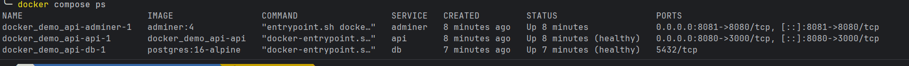

# demo-api

## Démarrage avec Compose

Depuis la racine du dépôt, copier la configuration puis modifier le mot de
passe local :

```sh
cp .env.example .env
```

Lancer la stack :

```sh
docker compose up -d --build
```

L'API est disponible sur `http://localhost:${API_PORT:-8080}` et Adminer sur
`http://localhost:${ADMINER_PORT:-8081}` (ça dépend des var d'env définies) et PostgreSQL n'est pas accessible depuis
l'host. 

Dans Adminer, il faut utiliser `db` comme serveur et les valeurs de
`POSTGRES_USER`, `POSTGRES_DB` et `DB_PASSWORD` définies dans `.env`.


## Variables et secrets
 
Les variables sont définies dans `.env`, qui est ignoré par grace au .gitignore . Le mot de
passe est monté dans les conteneurs par le secret Compose `db_password` :
PostgreSQL le lit via `POSTGRES_PASSWORD_FILE` et l'API via
`PGPASSWORD_FILE`.

## Vérification

Commande testée :

```sh
docker compose up -d --build
docker compose ps
curl -s localhost:8080/products
curl -s -X POST -H 'content-type: application/json' \
  -d '{"name":"Gourde","price_cents":900}' localhost:8080/products
docker compose down
docker compose up -d
curl -s localhost:8080/products
```

Extrait attendu de `docker compose ps` :



Le produit `Gourde` reste présent après `down` puis `up` pcq stocké dans le volume
`pgdata`. 

`db/init.sql` n'est exécuté qu'au premier démarrage d'un
volume vide.

## Repartir de zéro

Pour supprimer les données PostgreSQL et rejouer `db/init.sql` :

```sh
docker compose down -v
docker compose up -d --build
```